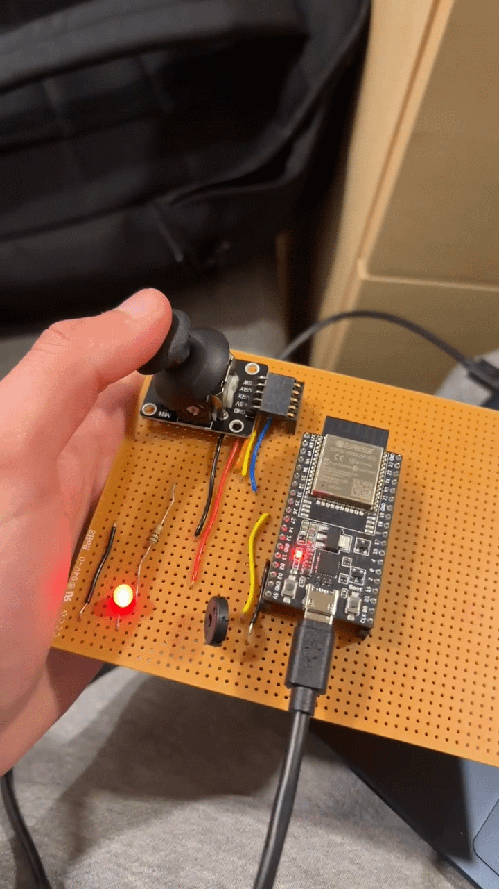
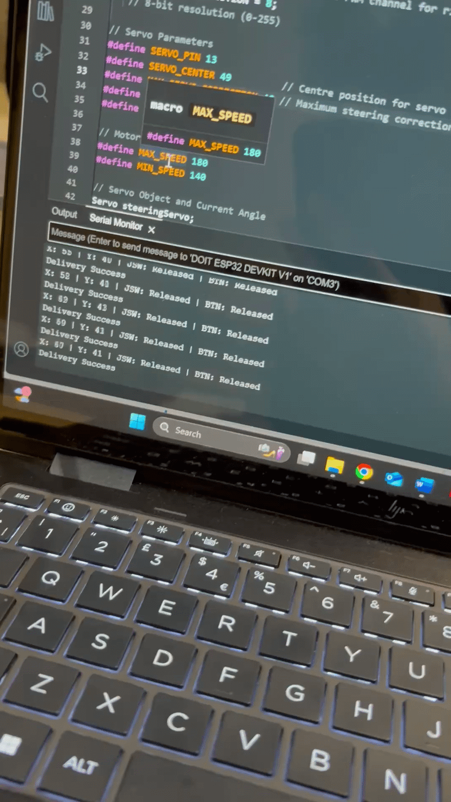
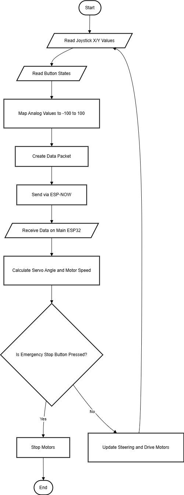

# ESP32 Wireless Joystick Robot Control

Design and implementation of a wireless joystick-controlled robot using two ESP32 microcontrollers and ESP-NOW communication. The project integrates analogue joystick inputs, wireless data transmission, DC motor speed control, servo steering and a software emergency-stop function.

Developed as part of an Electrical and Electronic Engineering laboratory project, building upon previous EEEbot construction and motor-control work.

## Demo / Images

### Wireless Joystick Controller

Original animated recording of the ESP32 wireless controller, including the analogue joystick, indicator LED and buzzer.

### ESP-NOW Communication Testing

Animated recording of the Arduino IDE Serial Monitor displaying joystick X/Y readings, button states and successful ESP-NOW delivery-status messages.

### Controller Wiring Diagram

Original stripboard wiring diagram showing the ESP32, analogue joystick and associated connections.

### ESP-NOW Control Flowchart

Original laboratory flowchart illustrating joystick input processing, wireless communication, motor control and emergency-stop logic.

Additional diagrams and descriptions are available in the [Project Documentation](docs/README.md).

## Hardware

- 2 × ESP32 development boards
- Analogue joystick module with integrated push-button
- Separate push-button for emergency stop
- EEEbot robotic chassis
- DC motors
- Motor-driver circuitry
- Servo motor
- Power supply and connecting wires
- Breadboard and jumper wires
- USB cables for programming and testing

## Pin Configuration

### Wireless Controller ESP32

| Component | ESP32 GPIO | Function |
|---|---|---|
| Joystick X-axis (VRX) | GPIO34 | Analogue steering input |
| Joystick Y-axis (VRY) | GPIO35 | Analogue speed input |
| Joystick push-button (SW) | GPIO32 | Joystick switch input |
| Separate push-button (BTN) | GPIO33 | Emergency-stop command |
| LED | GPIO25 | ESP-NOW transmission status |
| Joystick VCC | 3.3V | Power supply |
| Joystick GND | GND | Common ground |

The joystick produces analogue readings between 0 and 4095, which are mapped to control values of approximately -100 to +100.

The separate push-button connected to GPIO33 sends the emergency-stop command. The joystick's integrated switch is read separately.

### Robot Receiver ESP32

| Component | ESP32 GPIO | Function |
|---|---|---|
| Motor A enable (enA) | GPIO33 | PWM motor-speed control |
| Motor B enable (enB) | GPIO25 | PWM motor-speed control |
| Motor A direction (INa) | GPIO26 | Motor direction |
| Motor A direction (INb) | GPIO27 | Motor direction |
| Motor B direction (INc) | GPIO14 | Motor direction |
| Motor B direction (INd) | GPIO12 | Motor direction |
| Steering servo | GPIO13 | Servo control signal |

These receiver pin assignments are taken from the wireless control implementation in the laboratory report.

The controller and receiver are separate ESP32 boards, so identical GPIO numbers can be used for different components.

**Hardware note:** GPIO12 is a boot-strapping pin on the original ESP32. External circuitry must not interfere with the required startup state.

## How it works

The system consists of two ESP32 microcontrollers communicating wirelessly using ESP-NOW.

The controller ESP32 reads the joystick position and button states, processes the inputs and sends the information to the receiver.

The receiver ESP32 interprets the commands and controls the robot's DC motors and steering servo.

### 1. Joystick Input

The analogue joystick produces voltage signals corresponding to its horizontal and vertical positions.

The ESP32's analogue-to-digital converter (ADC) reads these voltages as digital values.

The readings are mapped from the 12-bit ADC range of 0–4095 to approximately -100 to +100.

- X-axis: Steering input.
- Y-axis: Motor speed and direction input.
- Integrated joystick switch: Additional digital input.
- Separate push-button: Emergency-stop command.

### 2. ESP-NOW Wireless Communication

ESP-NOW is a wireless communication protocol supported by ESP32 microcontrollers.

It enables compatible devices to communicate directly without requiring a conventional Wi-Fi network.

The controller packages joystick values and button states into a data structure and transmits this information using ESP-NOW.

The receiver extracts the incoming data and uses the values to calculate the motor and steering commands.

### 3. DC Motor Speed Control

The receiver processes the joystick Y-axis value to determine the requested motor speed and direction.

Pulse-width modulation (PWM) is used to regulate motor speed.

Direction-control signals determine whether the motors rotate forwards or backwards.

Changing the joystick position changes the requested movement.

### 4. Servo Steering

The receiver processes the joystick X-axis value to determine the steering position.

The joystick input is mapped to a servo angle, allowing the robot to steer left and right.

### 5. Emergency Stop

A separate push-button connected to GPIO33 on the controller sends the emergency-stop command.

When the receiver detects this command, it stops the DC motors.

This is a software-based stop function dependent on wireless communication, rather than an independently rated hardware emergency-stop system.

## System Architecture

The wireless control system consists of two embedded subsystems.

### Transmitter — Controller ESP32

1. Read the joystick X-axis from GPIO34.
2. Read the joystick Y-axis from GPIO35.
3. Read the integrated joystick switch from GPIO32.
4. Read the separate push-button from GPIO33.
5. Map the analogue values into control commands.
6. Package the joystick readings and button states.
7. Transmit the data using ESP-NOW.

### Receiver — Robot ESP32

1. Receive the ESP-NOW data packet.
2. Extract the joystick values and button states.
3. Check the emergency-stop command.
4. Calculate motor speed and direction.
5. Update the motor-driver control signals.
6. Calculate the steering angle.
7. Update the steering servo.

## Software

### Development Environment

- Arduino IDE
- Arduino C/C++
- ESP32 board support package
- ESP-NOW communication library
- Wi-Fi library for ESP32 wireless configuration
- ESP32Servo library for steering control

### Project Files

| File | Description |
|---|---|
| `controller/controller.ino` | Reads joystick inputs and transmits ESP-NOW control data |
| `receiver/receiver.ino` | Receives wireless commands and controls motors and steering |
| `docs/README.md` | Original wiring diagram, flowchart, animated recordings and testing documentation |

The transmitter and receiver use separate Arduino sketches because each ESP32 performs a different role.

**Compatibility note:** The uploaded Arduino sketches have not been independently recompiled or retested. ESP-NOW callback signatures vary between Arduino-ESP32 2.x and 3.x, so code adjustments may be required depending on the installed board package.

## Build & Run

### 1. Assemble the Wireless Controller

1. Connect joystick VRX to GPIO34.
2. Connect joystick VRY to GPIO35.
3. Connect joystick SW to GPIO32.
4. Connect the separate push-button to GPIO33.
5. Connect the joystick power supply to 3.3V and GND.
6. Connect the status LED according to the controller circuit.
7. Verify all wiring before applying power.

### 2. Prepare the Robot Receiver

1. Connect the receiver ESP32 to the EEEbot motor-driver circuitry.
2. Connect motor enable signals to GPIO33 and GPIO25.
3. Connect motor direction signals to GPIO26, GPIO27, GPIO14 and GPIO12.
4. Connect the steering servo signal to GPIO13.
5. Verify power supply and common ground connections.
6. Check the motor-driver wiring before powering the robot.

### 3. Configure ESP-NOW

1. Identify the receiver ESP32's Wi-Fi MAC address.
2. Configure the controller sketch with the correct receiver address.
3. Ensure the transmitter and receiver data structures match.
4. Upload the controller sketch to the transmitter ESP32.
5. Upload the receiver sketch to the robot ESP32.

### 4. Test the System

1. Power both ESP32 boards.
2. Open the Arduino IDE Serial Monitor where required.
3. Check the analogue joystick readings.
4. Verify ESP-NOW data transmission.
5. Test forward and reverse movement commands.
6. Test steering control.
7. Press the separate emergency-stop button.
8. Confirm that the receiver commands the motors to stop.

**Safety:** Initial testing should be performed with the drive wheels raised. The software stop depends on wireless communication and must not be relied upon as an independent safety mechanism.

## Results / Notes

### Successful Implementation

The laboratory project demonstrated:

- Wireless communication between two ESP32 microcontrollers.
- Analogue joystick input processing.
- Transmission of joystick and button data using ESP-NOW.
- Wireless DC motor control.
- Servo-based steering.
- A software emergency-stop command.

The wireless joystick-control system was successfully demonstrated during laboratory testing.

### Observations

Some motor movement jitter and power fluctuations were observed at higher motor speeds.

These observations highlighted the importance of reliable control signals, stable power delivery and testing under different operating conditions.

### Limitations

- Motor movement was not always smooth at higher speeds.
- Power fluctuations affected the consistency of operation.
- The system depended on successful wireless communication.
- The receiver sketch did not implement an automatic communication-loss timeout.
- The emergency-stop function depended on successful packet transmission.
- Additional ultrasonic sensor-feedback functionality was not successfully completed and is not included as an operational feature.

### Future Improvements

- Improve power supply stability.
- Implement a communication-loss timeout that automatically stops the motors.
- Introduce joystick calibration and dead-zone handling.
- Refine PWM motor-speed control.
- Improve servo steering response.
- Investigate closed-loop motor control using encoder feedback.
- Add reliable sensor feedback following further hardware testing.

## What I Learned

- How ESP-NOW enables wireless communication between ESP32 microcontrollers.
- How to read analogue joystick inputs using an ADC.
- How to map sensor values into movement commands.
- How to transmit structured data between embedded devices.
- How to integrate wireless communication with motor and servo control.
- How to implement a software emergency-stop command.
- How to test and troubleshoot a multi-microcontroller system.
- Why stable power delivery and communication reliability are important in embedded robotics.

## Related Projects

This project builds upon previous electronics and robotics work:

- [EEEbot Robot Construction](https://github.com/farazali-24/eeebot-robot-construction)
- [H-Bridge DC Motor Control](https://github.com/farazali-24/h-bridge-dc-motor-control)

## Credits

Developed as part of an Electrical and Electronic Engineering laboratory project.

**Hardware:**
- ESP32 microcontrollers
- Analogue joystick module
- EEEbot robotic platform
- DC motors and motor-driver circuitry
- Steering servo
- Laboratory power supplies and test equipment

## License

This project is licensed under the MIT License. See [LICENSE](LICENSE) for details.
