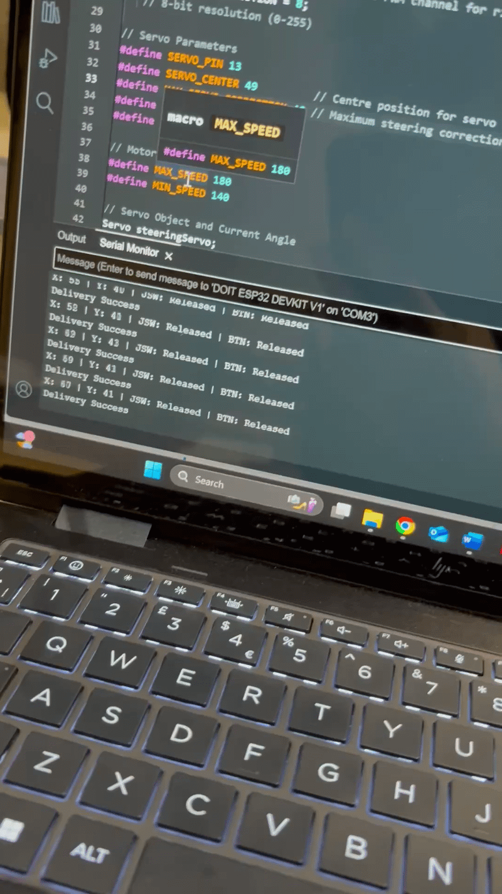

# ESP32 Wireless Joystick Robot Control — Documentation

This folder contains the original circuit diagrams, flowchart, hardware photographs and testing evidence from the ESP32 Wireless Joystick Robot Control laboratory project.

## 1. Controller Circuit Diagram

Original wiring diagram showing the ESP32 connections to the analogue joystick and associated components.

The diagram also includes components intended for additional sensor feedback, which was not fully implemented.

## 2. ESP-NOW Control Flowchart

Flowchart illustrating the joystick input processing, wireless data transmission and robot-control sequence.

## 3. Wireless Joystick Controller — Physical Construction

Original animated recording of the physical controller assembled on stripboard, showing the ESP32, analogue joystick, indicator LED and buzzer.

The buzzer was part of the hardware assembly, but the additional sensor-feedback functionality was not successfully completed.

## 4. ESP-NOW Communication Testing

Animated recording of the Arduino IDE Serial Monitor displaying joystick X/Y readings, button states and successful ESP-NOW transmission messages.

The repeated "Delivery Success" messages provide evidence of successful wireless data transmission during laboratory testing.

## 5. Additional Laboratory Testing Evidence

Original testing screenshot extracted from the laboratory report.

## Notes

- All diagrams and recordings document the original university laboratory work.
- The system uses two ESP32 microcontrollers communicating through ESP-NOW.
- The controller processes analogue joystick inputs and button states.
- The receiver controls the robot's DC motors and steering servo.
- Additional ultrasonic sensor-feedback functionality was not successfully completed and is not presented as an operational feature.

For the full project description, pin configurations and Arduino code, return to the [main README](../README.md).
