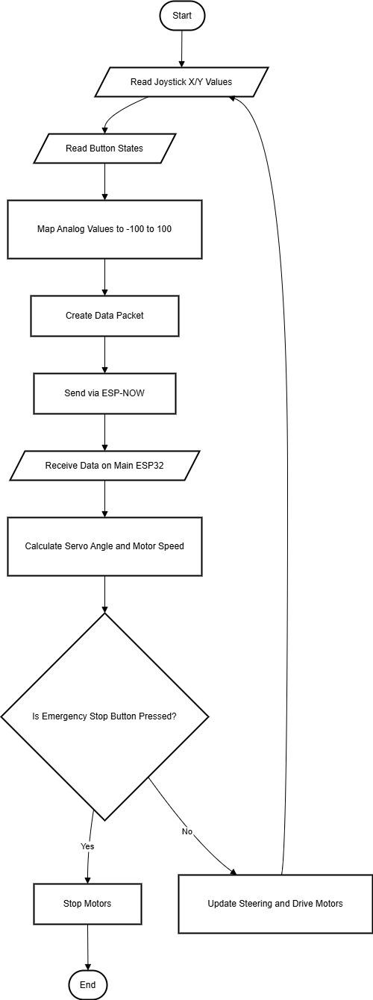
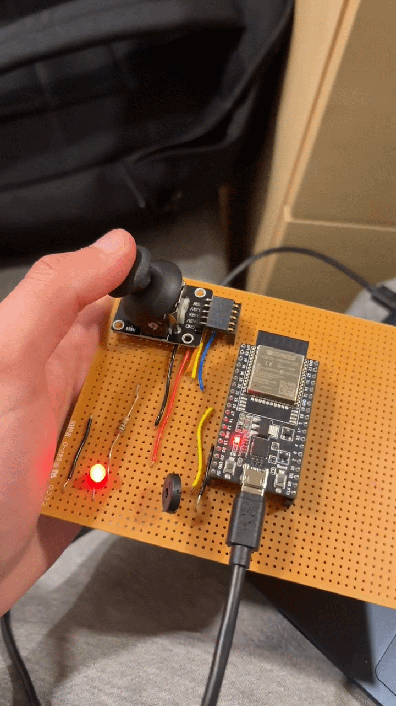

# ESP32 Wireless Joystick Robot Control — Documentation

This folder contains the original controller wiring diagram, system flowchart, animated hardware recording and wireless communication testing evidence from the ESP32 Wireless Joystick Robot Control laboratory project.

## 1. Controller Wiring Diagram

Original stripboard wiring layout showing the ESP32, analogue joystick and associated components.

The layout also includes components intended for additional sensor feedback, which was not fully implemented.

## 2. ESP-NOW Control Flowchart

Original flowchart illustrating joystick input processing, ESP-NOW communication and the robot-control sequence.

## 3. Wireless Joystick Controller — Physical Construction

Animated recording of the physical controller assembled on stripboard, showing the ESP32, analogue joystick, indicator LED and buzzer.

The buzzer was part of the hardware assembly, but the additional sensor-feedback functionality was not successfully completed.

## 4. ESP-NOW Communication Testing

Animated recording of the Arduino IDE Serial Monitor displaying joystick X/Y values, button states and ESP-NOW delivery-status messages.

The repeated "Delivery Success" messages provide evidence of successful wireless transmission during laboratory testing.

## Notes

- All diagrams and recordings document the original university laboratory work.
- The system uses two ESP32 microcontrollers communicating through ESP-NOW.
- The controller processes analogue joystick inputs and button states.
- The receiver processes wireless commands to control the robot's DC motors and steering servo.
- Additional ultrasonic sensor-feedback functionality was not successfully completed and is not presented as an operational feature.

For the full project description, pin configurations and Arduino sketches, return to the [main README](../README.md).
